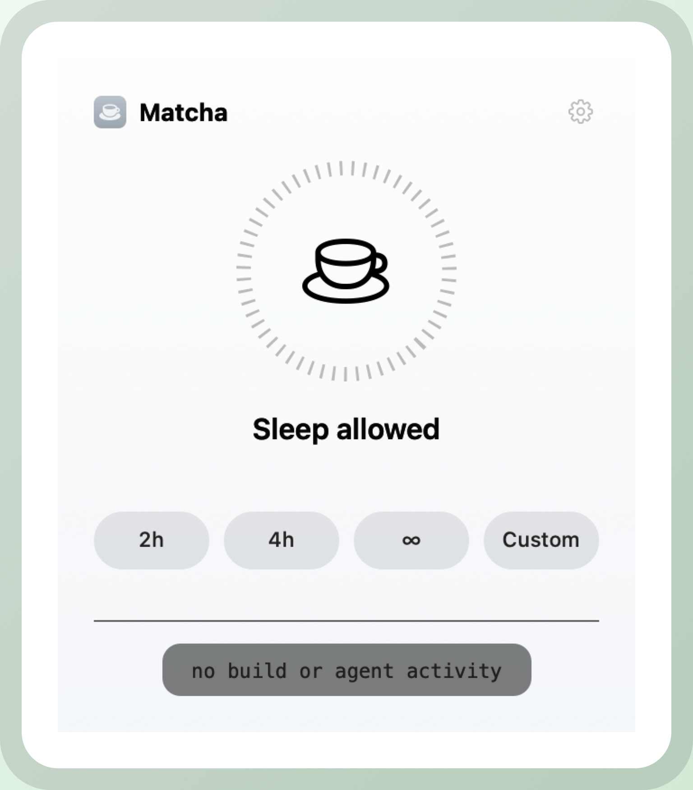
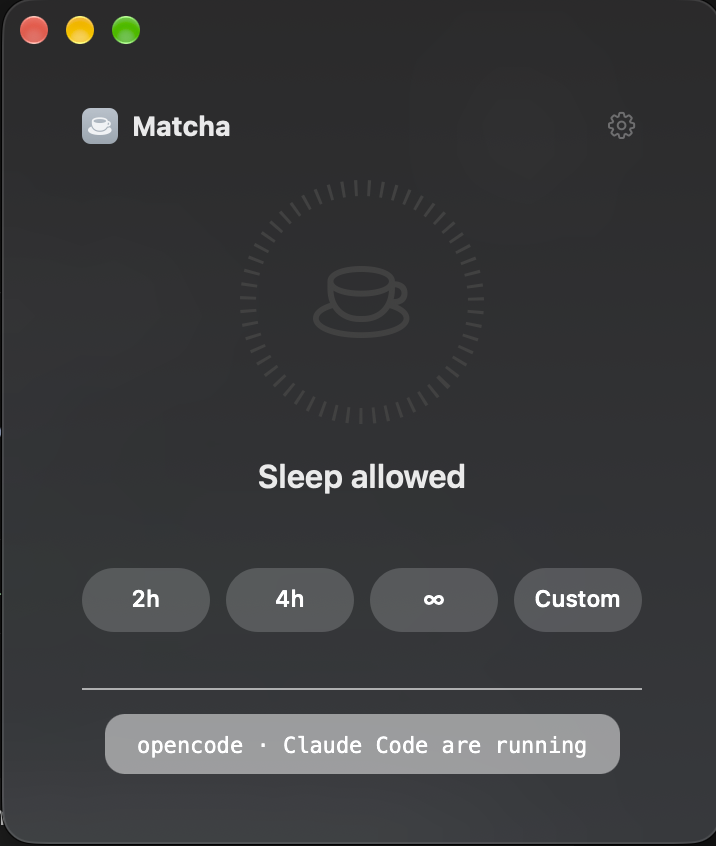
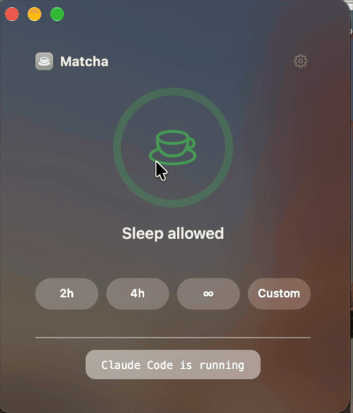

# Matcha

**Keep your Mac awake for builds, exports, and AI coding agents.**

[](https://github.com/jakeantelis/Matcha/releases) [](LICENSE)

<p align="center">
  
  
</p>

<p align="center"><b>Works with</b> · Claude Code · Codex · Cursor · opencode · Aider · Gemini CLI · Windsurf</p>

<p align="center"></p>

Tiny macOS app with a floating timer, menu bar controls, global hotkeys, CLI, and agent skill. Keeps your display on and lock screen away while builds, exports, or AI coding agents run. Crash-safe and scriptable.

## Install

One command:

```sh
curl -fsSL https://raw.githubusercontent.com/jakeantelis/Matcha/main/Tools/install.sh | sh
```

This downloads the latest release, verifies its SHA-256, installs it to
`/Applications`, opens it, and configures any coding agents it finds. Rerun the
same command to update. Skip the agent setup with `| sh -s -- --no-agents`.

Requires macOS 11 or later. Universal binary for Apple silicon and Intel.
Allow notifications when macOS asks; that is how the five-minute warning and
agent prompts reach you.

**Not notarized.** Ad-hoc signed, not notarized by Apple. The one-command installer
removes quarantine automatically. For manual downloads, right-click → Open or
**System Settings → Privacy & Security → Open Anyway**. Notarization may come
later if there's demand.

<details>
<summary>Manual install</summary>

```sh
curl -fL https://github.com/jakeantelis/Matcha/releases/latest/download/Matcha.zip -o /tmp/Matcha.zip
unzip -qo /tmp/Matcha.zip -d /Applications
xattr -dr com.apple.quarantine /Applications/Matcha.app 2>/dev/null || true
open /Applications/Matcha.app
```

The app is ad-hoc signed, not notarized. If Gatekeeper warns on first launch,
right-click the app and choose **Open**, or allow it under
**System Settings → Privacy & Security → Open Anyway**.

</details>

## Use

Click the ring to start or stop. Pick a preset (2h, 4h, 8h, ∞) or type a
duration such as `8`, `90m`, `2.5h`, `1d`, or `2h 30m`.

- **Floating indicator** — drag it anywhere; click or right-click for quick
  controls. Size it under **Indicator Size**. Double-click when active adds
  30 minutes, Option-click stops. Tags along across Spaces.
- **Menu bar** — optional icon with the same controls, plus an optional live
  countdown (**Show Time in Menu Bar**).
- **Ending warning** — five minutes before a session ends, Matcha offers
  **Add 1 Hour** or **Stop**. If a watched build is still running, it extends
  30 minutes automatically.
- **Display unlock** — prevents the screen saver and lock screen, not just
  idle sleep.
- **Crash-safe** — timed sessions resume after a crash or force-quit; an
  intentional Quit ends the session.
- **Battery guard** — stops at 20% on battery (laptops only).
- **Auto-keep awake for code** — if you step away while a real build or encode
  tool is running, Matcha offers to stay awake. Idle AI apps are ignored on
  purpose; agents should report long jobs explicitly via the CLI.
- Launch at login, light/dark/system appearance.

| Shortcut | Action |
| --- | --- |
| `⌃⌥⌘M` | Start or stop |
| `⌃⌥⌘1` | Start one hour |

## Automation

```sh
matchactl on            # until stopped
matchactl on 2          # 2 hours
matchactl extend 1      # add an hour
matchactl off
matchactl toggle
matchactl status        # -> on (3598s left) / coding activity: true
matcha run -- npm test  # keep awake, run command, auto-stop
```

The CLI lives inside the bundle, so it works without a PATH setup:

```sh
/Applications/Matcha.app/Contents/Resources/matchactl status
```

URL scheme:

```sh
open -g "matcha://on?hours=2"
open -g "matcha://on?minutes=45"
open -g "matcha://extend?hours=1"
open -g "matcha://off"
open -g "matcha://toggle"
```

`-g` keeps Matcha in the background. Live status is written to
`~/Library/Application Support/Matcha/status.plist` for tooling.

## Agents

The installer configures every agent it can find, using a managed block that is
safe to re-run:

| Agent | What it configures |
| --- | --- |
| Claude Code | `~/.claude/skills/matcha-keep-awake/SKILL.md` |
| opencode | `~/.config/opencode/skills/matcha-keep-awake/SKILL.md` |
| Codex CLI | `~/.codex/AGENTS.md` |
| Gemini CLI | `~/.gemini/GEMINI.md` |
| Windsurf | `~/.codeium/windsurf/memories/global_rules.md` |

Cursor and Aider load rules per project. Run this inside the repo:

```sh
curl -fsSL https://raw.githubusercontent.com/jakeantelis/Matcha/main/Tools/install-agent-kit.sh | sh -s -- --project
```

That adds `.cursor/rules/matcha-keep-awake.mdc` and appends the snippet to
`CONVENTIONS.md`. For Zed or any other agent, paste
[`Agent/instructions.md`](Agent/instructions.md) into its instructions.

Agents start a session before long work and stop it afterwards, leaving any
session you started yourself untouched.

## Updating

Rerun the install command. Matcha quits, updates, reopens, and resumes a running
session. You can also use **Matcha → Check for Updates…** in the app menu.

## Uninstalling

```sh
curl -fsSL https://raw.githubusercontent.com/jakeantelis/Matcha/main/Tools/uninstall.sh | sh
```

This removes the app and the instructions it added to coding agents. Add
`-s -- --yes --purge` to skip the prompt and delete preferences and session data
too. Cursor/Aider project rules are left for you to review and delete.

## Privacy

No accounts, analytics, or telemetry. The app makes one network request only
when you choose **Check for Updates…**, and the installer contacts GitHub to
download the release you asked for.

## Build from source

```sh
./build.sh install     # build and install to /Applications/Matcha.app
./build.sh build       # build only, into build/Matcha.app
./build.sh package     # build + dist/Matcha.zip
```

This needs the Xcode Command Line Tools (`swiftc`). Built locally, the app is not
quarantined and launches normally.

Maintainer commands:

```sh
./Tools/release.sh            # universal build, zip + SHA-256
./Tools/release.sh --publish  # same, then create the GitHub release
swift Tools/make-icon.swift ./Resources   # regenerate the app icon
```

Preview renders:

```sh
build/Matcha.app/Contents/MacOS/Matcha --render panel-idle.png --idle
build/Matcha.app/Contents/MacOS/Matcha --render panel-active.png
build/Matcha.app/Contents/MacOS/Matcha --render-badge badge.png --active
```

## License

[MIT](LICENSE)
