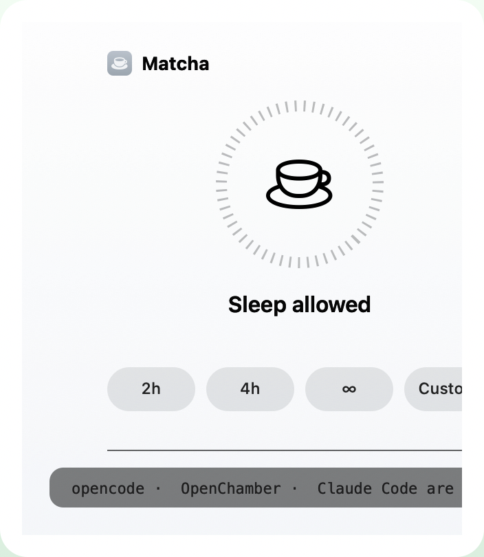

# Matcha

**Keep your Mac awake for builds, exports, and AI coding agents — with a cup of calm.**

[](https://github.com/jakeantelis/Matcha/releases)
[](LICENSE)
[]()
[]()

<p align="center">
  
  
  
</p>

<p align="center"><b>Works with</b> · Claude Code · Codex · Cursor · opencode · Aider · Gemini CLI · Windsurf · <i>and 40+ more</i></p>

Matcha is a tiny menu-bar utility that keeps your display on and the lock screen
away while builds, exports, or AI coding agents run. It looks like a tea timer —
because that's all it is — but it's built for the people who actually leave
machines working overnight.

## Install

```sh
curl -fsSL https://raw.githubusercontent.com/jakeantelis/Matcha/main/Tools/install.sh | sh
```

One command. It downloads the latest release, verifies its SHA-256, installs to
`/Applications`, launches it, and configures your coding agents. Rerun it any
time to update. Skip agent setup with `| sh -s -- --no-agents`.

Requires **macOS 11+** (universal — Apple silicon and Intel). Allow notifications
for the five-minute warning and agent prompts.

> **Not notarized.** Ad-hoc signed for now. The installer strips quarantine
> automatically; for manual downloads use right-click → Open. Notarization and a
> Homebrew cask land once an Apple Developer ID is available.

## What it does

- **Steep a session** — one click, or pick `2h` / `4h` / ∞, or type `90m`, `2h 30m`, `until 6pm`.
- **Tea-fill timer** — a matcha-green ring fills and a soft steam rises as time drains; the countdown lives in the ring, a floating badge, and the menu bar.
- **Display + lock screen** — prevents the screen saver *and* lock screen, not just idle sleep (`caffeinate -d -u` + IOPM assertions).
- **Watches your work** — detects running coding agents and paused builds, then offers to stay awake. Lists them: *“opencode · Claude Code are running.”*
- **Agents can self-serve** — `matcha run -- ./build.sh` stays awake for exactly as long as the command runs.
- **Crash-safe** — timed sessions resume after a crash or force-quit; a normal Quit ends them.
- **Battery guard** — stops at 20% on battery.
- **Schedules + watch-lists** — “until 6pm” or “stay awake while Logic Pro / Blender is open.”
- **Shortcuts & AppleScript** — fully scriptable via `matcha://` URL scheme and the `matchactl` CLI.

## Why not just use Amphetamine / Caffeinate?

| | **Matcha** | Amphetamine | Caffeinate |
|---|:---:|:---:|:---:|
| Keeps screen + lock screen awake | ✅ | ✅ | ⚠️ |
| **Detects your coding agents** | ✅ | — | — |
| **Agent skill + CLI (`matcha run`)** | ✅ | — | — |
| **Tea-fill timer / floating badge** | ✅ | — | — |
| Schedules & triggers | ✅ (until-time, watch-app) | ✅ | — |
| Shortcuts / AppleScript | ✅ | ✅ | — |
| Price | Free · OSS · MIT | Free + paid tier | Free · OSS |

Matcha is for the developer/export operator between midnight builds. If you just
want a blanket caffeinate, `caffeinate` is fine. If you want a **quiet, green,
agent-aware** timer that restores itself — that's Matcha.

## Quick tour

| Shortcut | Action |
| --- | --- |
| `⌃⌥⌘M` | Start / stop |
| `⌃⌥⌘1` | Start one hour |

```sh
matcha on 2            # steep for 2 hours
matcha run -- npm test # stay awake, run, auto-stop
matcha status --json   # machine-readable state
```

Live status is written to `~/Library/Application Support/Matcha/status.plist`.
The CLI lives inside the bundle, so it works with no PATH setup — perfect for
agents and shell scripts.

## Coding agents

Matcha ships an installable skill/instructions for Claude Code, opencode, Codex,
Gemini, Windsurf, Cursor, Aider and more. It detects **43 built-in agents**
(and anything you add) and can start a session before long work, then stop it —
leaving any session *you* started untouched.

Missing one? Settings → **Add Coding Agent…**, or drop process names into
`~/Library/Application Support/Matcha/agents.txt`. Detection is local; nothing
leaves your Mac.

## Updates

Checks on launch and once a day, then installs + restarts in one click — keeping
your current session and settings exactly as they were.

## Privacy

No account, no analytics, no telemetry. The only network calls are updating and
the install you asked for.

## Build from source

```sh
./build.sh install   # build → /Applications/Matcha.app
./build.sh package   # build + dist/Matcha.zip
./Tools/release.sh   # universal arm64+x86_64 + checksums
```

Needs only the Xcode Command Line Tools (`swiftc`).

## License

[MIT](LICENSE) — free to use, fork, and ship.