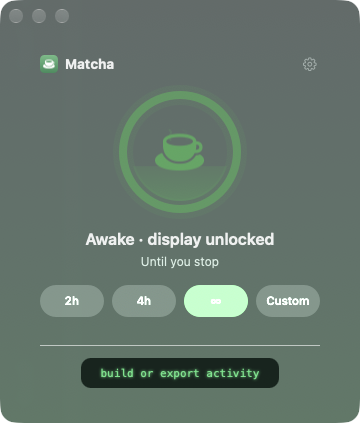
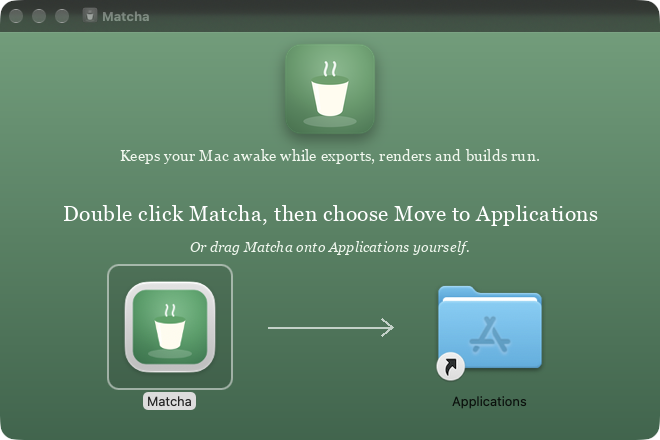
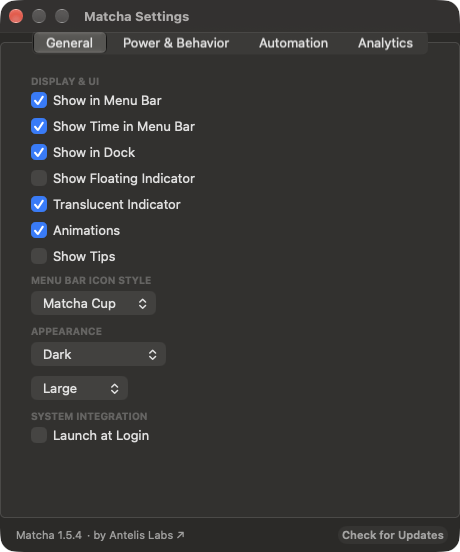
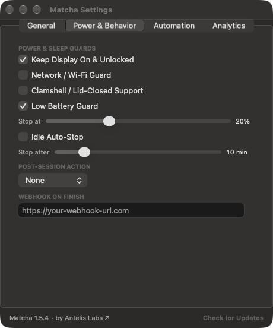
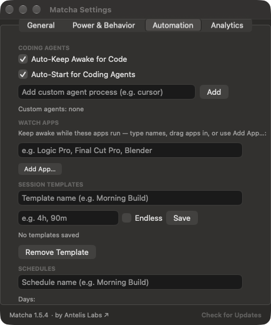

# Matcha

**Keep your Mac awake for exports, renders, downloads, and long builds.**

> **100% Free & Open Source (MIT)** · No accounts, no subscriptions, no tracking, and zero bloat. Built natively in Swift for macOS.

[](https://github.com/jakeantelis/Matcha/releases)
[](LICENSE)
[]()
[]()

<p align="center">
  
</p>

<p align="center"><b>Great for</b> · audio &amp; video exports · renders · big downloads · backups · long builds</p>

<p align="center"><b>Works with</b> · Claude Code · Cursor · Copilot · Codex · Gemini CLI · Windsurf · <i>and 39 more</i></p>

Matcha is a tiny Mac app that stops your Mac from sleeping or locking while something long is running: an export, a render, a big download, a backup or a build. Click the cup, pick how long, and walk away. When the time is up, it lets go and your Mac goes back to normal.

<p align="center">
  <a href="https://github.com/jakeantelis/Matcha/releases/latest/download/Matcha.dmg"><b>Download Matcha for Mac</b></a><br>
  Free. Needs macOS 11 or newer. Works on Apple silicon and Intel.
</p>

<p align="center"></p>

Made by [Antelis Labs](https://antelislabs.com). See what's new in [`RELEASE_NOTES.md`](RELEASE_NOTES.md).

## Install

**Most people: three steps, no Terminal.**

1. [Download Matcha.dmg](https://github.com/jakeantelis/Matcha/releases/latest/download/Matcha.dmg) and open it.
2. **Double click Matcha** and choose **Move to Applications**. Or drag **Matcha** onto the **Applications** folder yourself.
3. Matcha opens with a cup in your menu bar. Click it to start.

<p align="center"></p>

If macOS asks whether to open an app from the internet, choose **Open**. Matcha is signed and notarized by Apple. Allow notifications when asked, so Matcha can warn you before a session ends. Keep Matcha in Applications, not on the disk image.

**Updates:** Matcha checks GitHub for a new version about once a day and asks before installing anything. You can also open Settings and press **Check for Updates**.

**Remove it:** quit Matcha and drag it to the Trash. To also remove the settings and the notes it added for coding agents, run `Tools/uninstall.sh` (see below).

<details>
<summary>For developers: one command, Homebrew, or the zip</summary>

**One command**, which also sets up supported coding agents:

```sh
curl -fsSL https://raw.githubusercontent.com/jakeantelis/Matcha/main/Tools/install.sh | sh
```

It downloads the latest release, verifies its SHA-256 checksum, installs Matcha to `/Applications`, launches it and configures supported coding agents. Rerun it anytime to update. Skip agent setup with `| sh -s -- --no-agents`.

**Homebrew:** `brew install --cask matcha` (via the tap, see [Homebrew](#homebrew) below).

**Zip:** unzip `Matcha.zip` from the [releases page](https://github.com/jakeantelis/Matcha/releases) and move **Matcha.app** to **Applications**.

**Uninstall everything**, including what it added to coding agents:

```sh
curl -fsSL https://raw.githubusercontent.com/jakeantelis/Matcha/main/Tools/uninstall.sh | sh
```

</details>

## Features

- **One-click sessions**: presets (`2h` / `4h` / ∞), natural language (`8h`, `90m`, `2.5h`, `8 hours`), or clock time (`until 6pm`).
- **Tea-fill timer**: a matcha-green ring fills and steam rises while a session runs, with the live countdown in the ring, menu bar, and floating badge, plus elapsed run time in the window and menu-bar tooltip.
- **Display + lock screen**: prevents the screen saver *and* lock screen, not just idle sleep (`caffeinate -d -u` + IOPM assertions).
- **Floating indicator**: a draggable desktop badge with quick actions (double-click +30m, Option-click stop; translucent by default).
- **Agent-aware**: detects 45+ coding agents and lists the active ones: *“opencode · Claude Code are running.”*
- **CLI & scripting**: `matcha run -- <cmd>` stays awake for exactly as long as the command runs.
- **Crash-safe**: timed sessions resume after a crash or force-quit; a normal Quit ends them.
- **Battery guard**: stops at user-adjustable threshold (default 20%) on battery.
- **Watch-lists, schedules & templates**: stay awake while an app runs, at scheduled days/times, or with saved one-click session templates.
- **Idle auto-stop**: automatically stops if your Mac has been idle for a configured number of minutes.
- **Shortcuts & App Intents**: full Siri and Shortcuts support for starting, stopping, toggling, extending, and checking status.
- **xbar plugin**: integration for xbar / BitBar menu bar monitoring and control.
- **Network & Clamshell Guard**: Optional network sleep prevention (`NetworkClientActive`) and clamshell/lid-closed wake support when connected to power/display.
- **Quick Command Palette**: Spotlight-style instant launcher (`⌃⌥⌘K`) to type durations, templates, or commands.
- **Post-Session Actions**: Optionally play a sound or put your Mac to sleep when a session finishes.
- **Menu Bar Icon Customization**: Choose between the matcha cup, a minimal leaf, or a status dot icon.
- **Custom Agent Manager**: Easily add custom agent process names via Settings without manual file edits.
- **Export & Webhooks**: Export session history to JSON/CSV and dispatch webhooks on session completion.

## Control it your way

| Way | How |
| --- | --- |
| **Menu bar** | Click the cup icon → popover, or `⌘,` for the Settings window |
| **Floating badge** | Drag it anywhere; click for controls, right-click for quick actions |
| **Hotkeys** | `⌃⌥⌘M` toggle · `⌃⌥⌘1` start 1 hour · `⌃⌥⌘N` show/hide window · `⌃⌥⌘K` command palette |
| **CLI** | `matcha on 2h` · `matcha off` · `matcha run -- ./build.sh` · `matcha watch` |
| **URL / AppleScript** | `open -g "matcha://on?hours=2"` |

Whichever you choose, visual floater, menu bar, hotkeys, or pure CLI, Matcha has you covered.

### A closer look

| General | Power and sleep | Automation |
|---|---|---|
|  |  |  |

## How it compares

| Feature / Capability | **Matcha** | Amphetamine | Caffeinate (CLI) |
| :--- | :---: | :---: | :---: |
| **Prevents System Sleep** | ✅ | ✅ | ✅ |
| **Keeps Screen + Lock Screen Awake** | ✅ | ✅ | ⚠️ *(Requires `-d -u` flags)* |
| **Detects AI Coding Agents** (45+ built-in) | ✅ | ❌ | ❌ |
| **Agent CLI (`matcha run -- <cmd>`)** | ✅ | ❌ | ✅ *(native `caffeinate -i <cmd>`)* |
| **Tea-Fill Visual Timer & Floating Badge** | ✅ | ❌ *(Menu bar only)* | ❌ *(Terminal only)* |
| **Schedules & Watch-Lists** | ✅ | ✅ | ❌ |
| **Saved Session Templates** | ✅ | ❌ | ❌ |
| **Idle Auto-Stop & Battery Guard** | ✅ | ✅ | ❌ |
| **Network & Clamshell Guards** | ✅ | ✅ *(Wi-Fi + closed-display)* | ❌ |
| **Quick Command Palette (`⌃⌥⌘K`)** | ✅ | ❌ | ❌ |
| **Post-Session Actions** (Sound / Sleep) | ✅ | ❌ | ❌ |
| **Tabbed Local Analytics & Stats** | ✅ | ❌ | ❌ |
| **Shortcuts, Apple Intents & xbar** | ✅ | ✅ | ❌ |
| **App Architecture** | Zero-deps Native Swift | Native AppKit | Built-in Terminal Tool |
| **Price & License** | Free · OSS · MIT | Free | Free · OSS |

## Coding agents

Matcha ships skills/instructions for Claude Code, opencode, Codex, Gemini, Windsurf, Cursor, and Aider, and detects **45 built-in agents** plus anything you add.

**How detection works, you pick the level:**

| Mode | Behavior |
| --- | --- |
| **Detect & prompt** *(default)* | When an agent is running, Matcha sends a notification: *"Keep your Mac awake?"*, tap **Keep Awake** to start. Never turns on by itself. |
| **Auto-start** | Settings → **Auto-Start for Coding Agents**: Matcha starts the moment an agent appears and stops when the last one quits (waits a few minutes after a manual stop so it doesn't fight you). |
| **Self-serve** | Agents use `matcha run -- <cmd>` to stay awake for exactly the duration of the command. |

Missing one? Settings → **Add Coding Agent…**, or add names to `~/Library/Application Support/Matcha/agents.txt`.

## Raycast & Alfred

<details>
<summary>Raycast script commands</summary>

The [`Raycast/`](Raycast) folder contains ready-to-use commands, `matcha-toggle`, `matcha-on`, `matcha-off`, `matcha-status`. Point Raycast at the folder as a **Script Command Directory**.

</details>

<details>
<summary>Alfred workflow</summary>

1. **Keyword** trigger: `matcha` (argument optional)
2. **Run Script** (`/bin/zsh`):

```zsh
/Applications/Matcha.app/Contents/Resources/matchactl {query}
```

Type `matcha on 2h`, `matcha off`, or `matcha status` from Alfred.

</details>

## Questions

**Will it drain my battery?** Staying awake uses power, so Matcha has a **Low Battery Guard** (on by default, stops at 20%) and **Idle Auto-Stop**. Both are in Settings.

**Does it work with the lid closed?** Yes, with **Clamshell / Lid-Closed Support** turned on in Settings, while your Mac is on power and connected to a display.

**Is it safe to leave on?** A session ends when its timer runs out, when the battery guard trips, or when you stop it. Quitting Matcha always ends the session.

**Is the `matcha://` link safe?** Any web page can open a `matcha://` link, so these links can only do four things: start, stop, toggle or extend a session. They cannot read files or run anything.

**How is this different from caffeinate?** Same idea, with a window, a timer, schedules, a battery guard and awareness of coding agents. See [How it compares](#how-it-compares).

## Privacy

No accounts, analytics, or telemetry. The only network calls are updating and the install you asked for.

**A note on walking away:** Matcha keeps the lock screen away only while a session is active. If you tend to step away from your Mac, turn on **Idle Auto-Stop** (Settings) or use a timed session, so it never stays unlocked longer than you meant to. Idle Auto-Stop ends a manual session after a set idle period, and it leaves running builds, exports, and watched apps alone.

## Build from source

```sh
./build.sh install   # build → /Applications/Matcha.app
./build.sh package   # build + dist/Matcha.zip
./Tools/release.sh   # universal arm64+x86_64 + checksums
```

Needs only the Xcode Command Line Tools (`swiftc`).

### Homebrew

Install from the Matcha tap:

```sh
brew tap jakeantelis/matcha
brew install --cask matcha
```

The cask formula lives in [`Casks/matcha.rb`](Casks/matcha.rb).

## License

[MIT](LICENSE), free to use, fork, and ship.

## More from Antelis Labs

Matcha is made by [Antelis Labs](https://antelislabs.com), which makes native Mac and studio audio tools. See [antelislabs.com](https://antelislabs.com) for everything else.

A separate app, if you want it: [**Tarn**](https://github.com/jakeantelis/Tarn) is a calm focus timer with breathing breaks and soft sounds. It is not part of Matcha and does not keep your Mac awake. The two work well side by side: Matcha keeps the Mac awake, Tarn keeps you focused.
